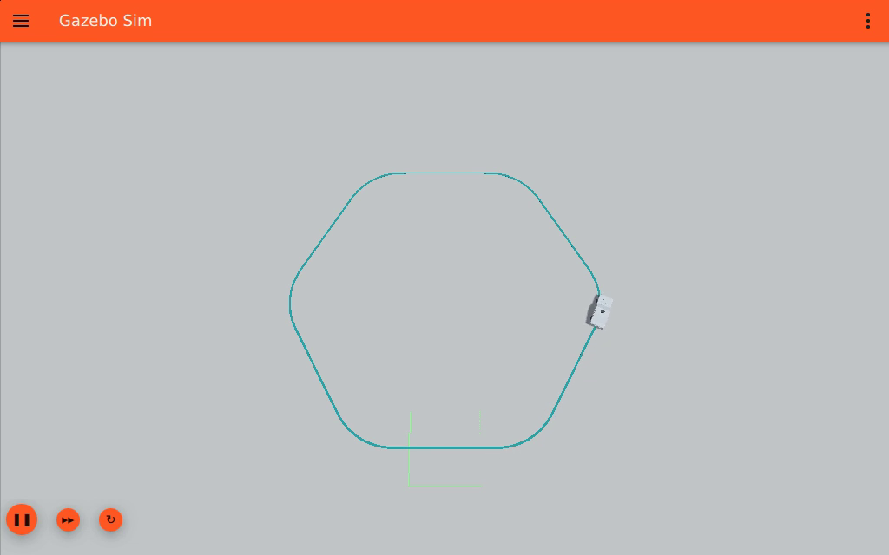
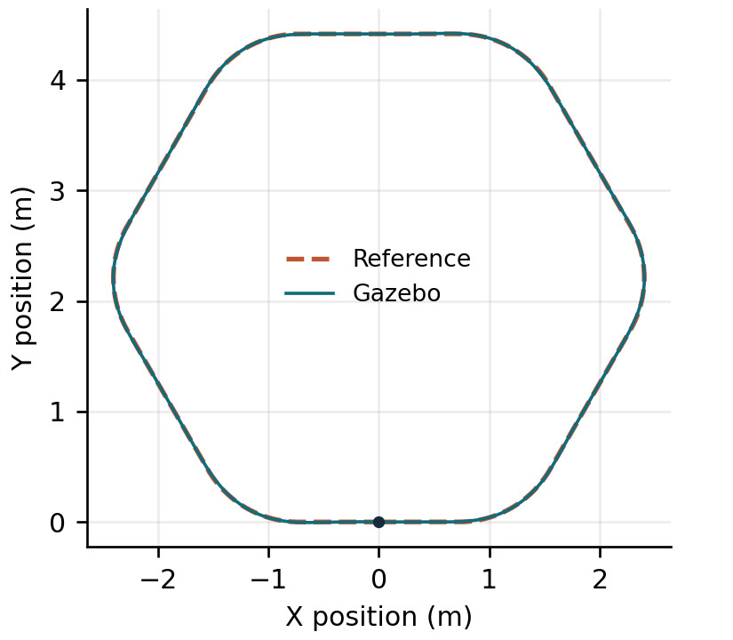
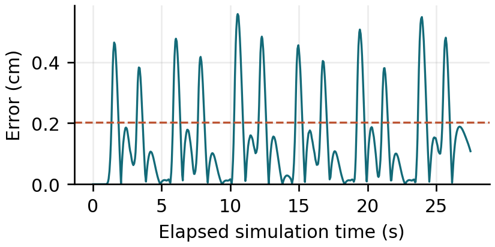

# Ackermann Challenger · Grupo 4

## Resumen

Robot móvil basado en el diseño del grupo en Autodesk Fusion 360. El modelo URDF/Xacro se importa a Gazebo Harmonic y un nodo ROS 2 Jazzy lo guía por un circuito hexagonal redondeado de 14,69 m mediante Pure Pursuit.

La corrida grabada terminó con estado `completed` y registró 551 muestras. El error es la distancia entre el centro del eje trasero y su proyección local sobre la referencia.

| Resultado de la corrida grabada | Valor |
|---|---:|
| Tiempo de simulación | 27,50 s |
| Error RMS de seguimiento | 2,0 mm |
| Error máximo de seguimiento | 5,6 mm |
| Distancia a la meta al ordenar la parada | 6,60 cm |

## Evidencias de la simulación

### Video en Gazebo

[](docs/resultados/gazebo_trayectoria.mp4)

El video muestra la salida, los seis giros y la parada. La captura se reproduce a 2× y las métricas usan el reloj de simulación. [Ver video completo en MP4](docs/resultados/gazebo_trayectoria.mp4)

### Trayectoria y error de seguimiento





[Resumen de métricas (JSON)](docs/resultados/summary.json) · [Telemetría de la corrida (CSV)](docs/resultados/tracking.csv)

### Vista del diseño en Fusion 360


[Archivo de Fusion 360](cad/fusion360/Ackermann_Challenger.f3d) · [Planos acotados](cad/planos/Ackermann_Challenger%20Planos.pdf)

## Compilar y ejecutar

Entorno objetivo: **Ubuntu 24.04 LTS, ROS 2 Jazzy y Gazebo Harmonic**. Si estás en Ubuntu 26.04, ejecuta estas instrucciones en una máquina virtual Ubuntu 24.04 para disponer de Jazzy y de la ventana de Gazebo. Configura primero el repositorio APT de ROS con la [guía oficial de Jazzy](https://docs.ros.org/en/jazzy/Installation/Ubuntu-Install-Debs.html).

```bash
sudo apt update
sudo apt install -y git make python3-colcon-common-extensions ros-jazzy-ros-base \
  ros-jazzy-ros-gz-sim ros-jazzy-ros-gz-bridge ros-jazzy-xacro
```

Para la visualización opcional en RViz, instala también `ros-jazzy-rviz2` y `ros-jazzy-joint-state-publisher-gui`. Para hacer gráficas, instala `python3-matplotlib`.

Si ya tienes el repositorio, abre una terminal en esta carpeta, donde están este README y los dos paquetes. Para clonar el proyecto por primera vez, ejecuta lo siguiente.

```bash
git clone https://github.com/FernandoVB01/Project-01-Robots-G4.git
cd Project-01-Robots-G4/Project-01-Robots-G4
```

Ejecuta desde esa carpeta.

```bash
source /opt/ros/jazzy/setup.bash
colcon build --symlink-install --packages-select \
  ackermann_challenger_description ackermann_challenger_control
source install/setup.bash
ros2 launch ackermann_challenger_control trajectory.launch.py
```

Gazebo abre el escenario con la línea de referencia. El controlador espera la pose del simulador, deja 2 s de margen para el arranque y comienza a avanzar. Cuando imprime `completed`, detiene el robot. Los archivos se guardan en `resultados/tracking.csv` y `resultados/summary.json`. Cierra Gazebo o pulsa `Ctrl+C` antes de iniciar otra corrida.

### Variantes

```bash
# Corrida sin interfaz
ros2 launch ackermann_challenger_control trajectory.launch.py gui:=false output_dir:=resultados/headless

# Modo gráfico con una espera de 8 s para empezar a grabar
ros2 launch ackermann_challenger_control trajectory.launch.py start_delay:=8.0 output_dir:=resultados/video

# Mostrar el robot sin iniciar la trayectoria
ros2 launch ackermann_challenger_description gazebo.launch.py

# Inspección de articulaciones y modelo en RViz, con los paquetes opcionales instalados
ros2 launch ackermann_challenger_description display.launch.py

# Rehacer las gráficas tras terminar la corrida
python3 tools/plot_results.py resultados/headless resultados/headless/figuras
```

| Argumento | Valor inicial | Función |
|---|---:|---|
| `gui` | `true` | Ventana de Gazebo |
| `drive` | `true` | Iniciar el seguidor |
| `speed` | `0.55` | Velocidad nominal en m/s |
| `lookahead` | `0.32` | Distancia de anticipación en m |
| `start_delay` | `2.0` | Espera en segundos de simulación tras recibir la pose |
| `output_dir` | `resultados` | Carpeta de telemetría |

Usa carpetas de salida distintas si quieres comparar corridas. Una corrida nueva reutiliza los nombres de archivo en la carpeta indicada.

Si la ventana de Gazebo tarda en dibujar el escenario, puedes separar la apertura de la ventana y el inicio del controlador. Primero ejecuta `ros2 launch ackermann_challenger_control trajectory.launch.py drive:=false`. Cuando se vea el circuito, abre otra terminal en la misma carpeta, carga los dos `setup.bash` y ejecuta lo siguiente.

```bash
ros2 run ackermann_challenger_control trajectory_tracker --ros-args \
  -p use_sim_time:=true -p output_dir:=resultados/video
```

### Diagnóstico

En una segunda terminal, carga los dos archivos `setup.bash` antes de ejecutar los comandos ROS 2.

```bash
ros2 topic echo /clock --once
ros2 topic echo /challenger/ground_truth --once
ros2 topic echo /challenger/cmd_vel --once
```

Si falta `/clock`, confirma que Gazebo esté ejecutándose sin pausa. Si no aparece `/challenger/ground_truth`, revisa el mensaje de inserción de `challenger` y los mensajes del puente `ros_gz_bridge`. El nodo registra `off_course` o `timeout` si activa la detención por desvío o tiempo.

## Diseño y funcionamiento

| Parámetro | Valor |
|---|---:|
| Distancia entre ejes | 300 mm |
| Separación de centros de rodadura | 190 mm |
| Separación de juntas de giro de rueda | 208 mm |
| Separación de pivotes delanteros | 120 mm |
| Diámetro y ancho de rueda | 70 mm y 26 mm |
| Recorrido de cada mangueta | ±35° |
| Lado del hexágono base | 2,55 m |
| Radio de los seis arcos | 0,95 m |
| Curvatura máxima de la referencia | 1,053 m⁻¹ |
| Curvatura máxima comandada | 1,8 m⁻¹ |

Las mallas de Fusion conservan su geometría original. Los centros de los neumáticos están desplazados 9 mm hacia dentro con respecto a las juntas de giro. Las ruedas usan colisiones cilíndricas y el chasis una caja central. El paquete de descripción instala el escenario, el modelo y el puente de Gazebo.

El seguidor proyecta la pose del punto medio del eje trasero sobre una ventana local de la referencia. Busca un objetivo adelantado, calcula la curvatura y publica la velocidad lineal y angular. El sistema Ackermann de Gazebo ajusta las manguetas delanteras con ganancia proporcional de 8,0 s⁻¹ y las velocidades de las dos ruedas traseras. La pose de referencia del simulador proporciona la realimentación y la medición.

La vuelta empieza en el punto medio de la primera recta. Los arcos giran 60° y son tangentes a las rectas contiguas. La curvatura de referencia es 0 en recta y 1/0,95 m⁻¹ en los arcos.

Si cambias la curva en `geometry.py`, ejecuta `python3 tools/update_course.py` y recompila para actualizar la marca visible del escenario.

## Entregables

- [Archivo de Fusion 360](cad/fusion360/Ackermann_Challenger.f3d) y [planos de las piezas](cad/planos/Ackermann_Challenger%20Planos.pdf). Lámina 1, ensamblaje y lista de 9 piezas. Lámina 2, base. Láminas 3–4, manguetas. Lámina 5, geometría de las cuatro ruedas. Lámina 6, carrocería. Lámina 7, LiDAR.
- [Informe IEEE en inglés (PDF)](docs/IEEE_AckermannG4.pdf).
- [Presentación de 10 diapositivas (PowerPoint)](docs/presentacion/Ackermann_G4.pptx) y [guion en inglés](docs/presentacion/guion.md).
- [Video, gráficas y datos de la corrida](#evidencias-de-la-simulación).
