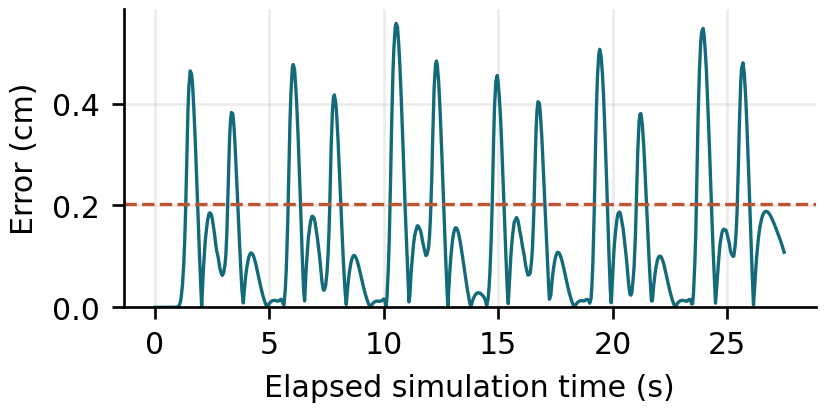
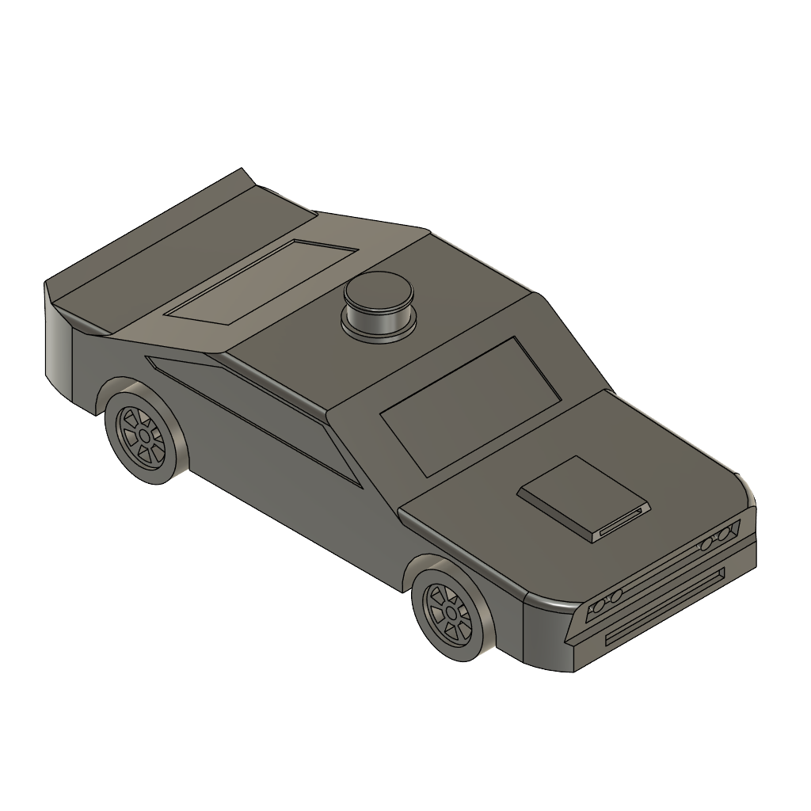

# Ackermann Challenger · Group 4

## Overview

This mobile robot uses the group's Autodesk Fusion 360 design. The URDF/Xacro model runs in Gazebo Harmonic, and a ROS 2 Jazzy node uses Pure Pursuit to guide it around a 14.69 m rounded hexagon.

The recorded run ended with status `completed` and logged 551 samples. Tracking error is the distance from the rear-axle midpoint to its local projection onto the reference route.

| Recorded run | Value |
|---|---:|
| Simulation time | 27.50 s |
| RMS tracking error | 2.0 mm |
| Maximum tracking error | 5.6 mm |
| Distance to the endpoint at the stop command | 6.60 cm |

## Simulation evidence

### Gazebo video

[](docs/results/gazebo-trajectory.mp4)

The video shows the start, all six turns, and the stop. The recording plays at 2× speed. The metrics use the simulation clock. [Watch the full MP4](docs/results/gazebo-trajectory.mp4)

### Path and tracking error




[Run summary (JSON)](docs/results/summary.json) · [Recorded telemetry (CSV)](docs/results/tracking.csv)

### Fusion 360 model



[Fusion 360 archive](cad/fusion360/Ackermann_Challenger.f3d) · [Dimensioned engineering drawings](cad/drawings/Ackermann_Challenger_Drawings.pdf)

## Build and run

Build with **Ubuntu 24.04 LTS, ROS 2 Jazzy, and Gazebo Harmonic**. On Ubuntu 26.04, run these steps in an Ubuntu 24.04 virtual machine to use Jazzy and the Gazebo GUI. Set up the ROS APT repository using the [official Jazzy installation guide](https://docs.ros.org/en/jazzy/Installation/Ubuntu-Install-Debs.html).

```bash
sudo apt update
sudo apt install -y git make python3-colcon-common-extensions ros-jazzy-ros-base \
  ros-jazzy-ros-gz-sim ros-jazzy-ros-gz-bridge ros-jazzy-xacro
```

For optional RViz visualization, install `ros-jazzy-rviz2` and `ros-jazzy-joint-state-publisher-gui`. To regenerate the plots, install `python3-matplotlib`.

If you already have the repository, open a terminal in the directory containing this README and the two ROS 2 packages. To clone it for the first time, run the following commands.

```bash
git clone https://github.com/FernandoVB01/Project-01-Robots-G4.git
cd Project-01-Robots-G4/Project-01-Robots-G4
```

Build and launch from that directory.

```bash
source /opt/ros/jazzy/setup.bash
colcon build --symlink-install --packages-select \
  ackermann_challenger_description ackermann_challenger_control
source install/setup.bash
ros2 launch ackermann_challenger_control trajectory.launch.py
```

Gazebo opens the course and displays the reference line. The controller waits for the simulator pose, pauses for 2 seconds, and starts the lap. It stops the robot when it reports `completed`. It saves data to `results/tracking.csv` and `results/summary.json`. Close Gazebo or press `Ctrl+C` before starting another run.

### Launch options

```bash
# Run without the GUI
ros2 launch ackermann_challenger_control trajectory.launch.py gui:=false output_dir:=results/headless

# Allow 8 seconds to start recording in the GUI
ros2 launch ackermann_challenger_control trajectory.launch.py start_delay:=8.0 output_dir:=results/video

# Show the robot without starting a lap
ros2 launch ackermann_challenger_description gazebo.launch.py

# Inspect the robot and its joints in RViz
ros2 launch ackermann_challenger_description display.launch.py

# Regenerate the plots after a run
python3 tools/plot_results.py results/headless results/headless/figures
```

| Argument | Default | Purpose |
|---|---:|---|
| `gui` | `true` | Open the Gazebo window |
| `drive` | `true` | Start the path tracker |
| `speed` | `0.55` | Nominal speed in m/s |
| `lookahead` | `0.32` | Look-ahead distance in m |
| `start_delay` | `2.0` | Delay in simulation seconds after the first valid pose |
| `output_dir` | `results` | Telemetry output directory |

Use separate output directories to compare runs. A new run reuses the same file names in its output directory.

If Gazebo takes time to render the course, open the window first with `ros2 launch ackermann_challenger_control trajectory.launch.py drive:=false`. Once the course is visible, open a second terminal in the same directory, source both setup files, and start the tracker.

```bash
ros2 run ackermann_challenger_control trajectory_tracker --ros-args \
  -p use_sim_time:=true -p output_dir:=results/video
```

### Troubleshooting

In a second terminal, source both setup files and check the ROS 2 topics.

```bash
ros2 topic echo /clock --once
ros2 topic echo /challenger/ground_truth --once
ros2 topic echo /challenger/cmd_vel --once
```

If `/clock` is missing, check that Gazebo is running and unpaused. If `/challenger/ground_truth` is missing, check the message confirming that `challenger` spawned and the logs from `ros_gz_bridge`. The tracker reports `off_course` or `timeout` when either condition triggers a stop.

## Design and operation

| Parameter | Value |
|---|---:|
| Wheelbase | 300 mm |
| Track width between tire centers | 190 mm |
| Wheel spin joint spacing | 208 mm |
| Front kingpin spacing | 120 mm |
| Wheel diameter and width | 70 mm and 26 mm |
| Steering range per knuckle | ±35° |
| Nominal hexagon side length | 2.55 m |
| Radius of the six arcs | 0.95 m |
| Maximum reference curvature | 1.053 m⁻¹ |
| Maximum commanded curvature | 1.8 m⁻¹ |

The model uses the original Fusion meshes for visualization. The tire centers are 9 mm inboard of the wheel spin joints. The wheels use cylindrical collision geometry, and the chassis uses a central box. The description package installs the world, the model, and the Gazebo bridge configuration.

The tracker projects the rear-axle midpoint onto a local segment of the reference. It selects a target ahead, computes curvature, and publishes linear and angular velocity commands. The Gazebo Ackermann system controls the front steering knuckles with a proportional gain of 8.0 s⁻¹ and sets the two rear wheel speeds. The simulator pose provides both feedback and the tracking measurements.

The lap begins at the midpoint of the first straight. Each arc turns 60° and meets the adjoining straight sections tangentially. The reference curvature is zero on the straights and 1/0.95 m⁻¹ on the arcs.

If you change the course in `geometry.py`, run `python3 tools/update_course.py` and rebuild to update the visible course markings.

## Deliverables

- [Fusion 360 archive](cad/fusion360/Ackermann_Challenger.f3d) and [dimensioned engineering drawings](cad/drawings/Ackermann_Challenger_Drawings.pdf). Sheet 1 covers the assembly and its nine parts. Sheet 2 shows the base chassis, sheets 3–4 the steering knuckles, sheet 5 the four wheels, sheet 6 the body, and sheet 7 the LiDAR.
- [IEEE paper (PDF)](docs/IEEE_AckermannG4.pdf).
- [10-slide presentation (PowerPoint)](docs/presentation/Ackermann_G4.pptx).
- [Simulation video, plots, and data](#simulation-evidence).
