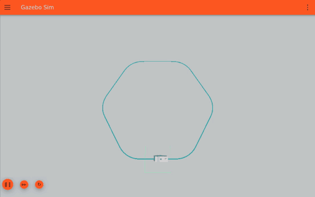
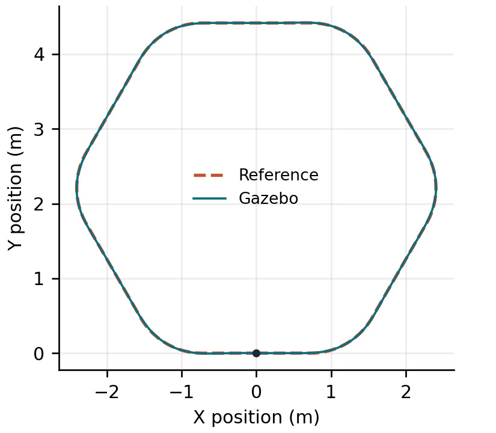

# Ackermann Challenger · Group 4

## Overview

An Ackermann-steered mobile robot designed in Fusion 360 and simulated in Gazebo Harmonic with ROS 2 Jazzy. The Pure Pursuit controller completed a **14.69 m rounded hexagon** with six straight sections and six circular arcs of radius 0.95 m.

| Recorded run | Value |
|---|---:|
| Simulation time | 27.50 s |
| RMS tracking error | 2.0 mm |
| Maximum tracking error | 5.6 mm |
| Distance to the endpoint at the stop command | 6.60 cm |

## Simulation video

The preview plays at an accelerated speed. [Watch the full MP4](Project-01-Robots-G4/docs/results/gazebo-trajectory.mp4)

## Tracking results

The plot overlays the reference route and the measured rear-axle path. [See the Gazebo screenshot, CAD model, and error plot](Project-01-Robots-G4/README.md#simulation-evidence) · [Recorded telemetry](Project-01-Robots-G4/docs/results/tracking.csv)

## Setup and deliverables

- [Dependencies, build steps, and ROS 2 commands](Project-01-Robots-G4/README.md#build-and-run)
- [Engineering drawings, IEEE paper, and presentation](Project-01-Robots-G4/README.md#deliverables)
