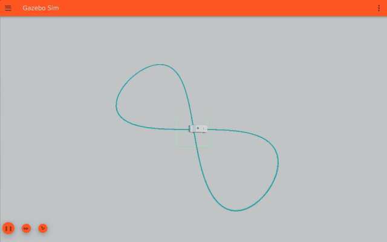

# Ackermann Challenger · Grupo 4

## Resumen

Robot móvil con dirección Ackermann, diseñado en Fusion 360 y simulado en Gazebo Harmonic con ROS 2 Jazzy. El controlador Pure Pursuit completó una trayectoria en ocho de **15,29 m**.

| Resultado de la corrida grabada | Valor |
|---|---:|
| Tiempo de simulación | 28,6 s |
| Error RMS de seguimiento | 1,2 mm |
| Error máximo de seguimiento | 3,3 mm |
| Distancia a la meta al ordenar la parada | 6,60 cm |

## Video de la simulación

La vista previa está acelerada. [Ver video completo en MP4](Project-01-Robots-G4/docs/resultados/gazebo_trayectoria.mp4)

## Evidencia de seguimiento

Las dos curvas se superponen a la escala de la gráfica. [Ver captura de Gazebo, diseño CAD y gráfica de error](Project-01-Robots-G4/README.md#evidencias-de-la-simulación) · [Datos de la corrida](Project-01-Robots-G4/docs/resultados/tracking.csv)

## Ejecución y entregables

- [Dependencias, compilación y comandos de ROS 2](Project-01-Robots-G4/README.md#compilar-y-ejecutar)
- [Planos, informe IEEE, diapositivas y guion](Project-01-Robots-G4/README.md#entregables)
